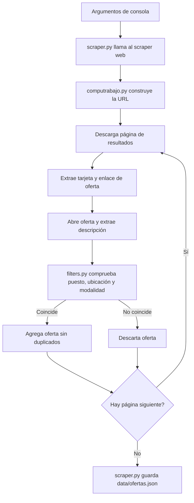

# Guía del scraper

Esta guía explica la estructura del proyecto y el recorrido de una oferta desde la búsqueda web hasta `data/ofertas.json`.

## Estructura

```text
scraper.py       # Interfaz de consola y archivo de salida
computrabajo.py  # Acceso y extracción de Computrabajo
filters.py       # Normalización y filtros de las ofertas
data/
└── ofertas.json # Resultados de la última ejecución
```

Cada módulo tiene una responsabilidad concreta:

- **`scraper.py`** recibe los argumentos, coordina la búsqueda y guarda el resultado.
- **`computrabajo.py`** construye la búsqueda, descarga las páginas, recorre la paginación y extrae los datos de las tarjetas y las ofertas individuales.
- **`filters.py`** normaliza textos y decide si una oferta satisface todos los filtros.

## Flujo de una búsqueda



Los datos se reúnen por oferta durante la misma búsqueda web. El título, empresa, ubicación y modalidad se leen de la tarjeta de resultados; la descripción se obtiene abriendo el enlace individual. `filters.py` aplica todos los filtros sobre esa oferta ya completa. No se leen ofertas de una ejecución previa.

## Requisitos y ejecución

Se requiere Python 3.10 o superior, `requests` y `beautifulsoup4`.

```cmd
python -m venv .venv
.venv\Scripts\activate.bat
pip install requests beautifulsoup4
```

Ejemplos:

```cmd
python scraper.py
python scraper.py --puesto "python" --ubicacion "Lima" --modalidad "remoto"
python scraper.py --puesto "software" --ubicacion "Arequipa" --modalidad "hibrido"
python scraper.py --puesto "qa" --modalidad "presencial"
```

En CMD, escribe cada comando en una sola línea; `\` no continúa un comando en ese shell.

### Argumentos

- `--puesto`: cargo, lenguaje, tecnología o framework que se buscará en el título y la descripción. Si se escriben varias palabras, todas deben aparecer; `python django` significa Python **y** Django.
- `--ubicacion`: texto que debe aparecer en la ubicación de la tarjeta. Puede omitirse.
- `--modalidad`: acepta `presencial`, `remoto` o `hibrido`. Puede omitirse para no filtrar por modalidad.

## `scraper.py`: CLI y guardado

### Imports y constante `SALIDA`

`argparse` procesa opciones de consola, `json` serializa la lista de resultados y `Path` maneja la ruta del archivo. `scrapear_ofertas` se importa de `computrabajo.py`. `SALIDA` apunta a `data/ofertas.json`.

### `guardar_ofertas(ofertas)`

Crea `data/` si hace falta y sobrescribe `data/ofertas.json` con los resultados de la búsqueda actual. No agrega resultados de ejecuciones anteriores.

### `main()`

Declara los argumentos, llama a `scrapear_ofertas()`, guarda lo que devuelve y muestra el total. La condición `if __name__ == "__main__"` ejecuta `main()` solo cuando se inicia `scraper.py` directamente.

## `computrabajo.py`: web y extracción

### `URL` y `HEADERS`

`URL` es la búsqueda base de software en Computrabajo Perú. `HEADERS` indica el agente y el idioma preferido para las solicitudes HTTP.

### `slug(texto)` y `construir_url(...)`

`slug()` normaliza un puesto o ubicación y convierte espacios a guiones. `construir_url()` usa la URL base para `software`, genera la ruta del puesto indicado, agrega ubicación y añade el sufijo de modalidad remoto o híbrido cuando corresponde. Presencial se comprueba con los datos extraídos de la tarjeta.

### `extraer_modalidad(box)`

Busca etiquetas `span.dIB.mr10` en la tarjeta. Si encuentra texto remoto o teletrabajo, devuelve `Remoto`; si también aparece presencial, devuelve `Presencial y remoto`. Si no encuentra esas etiquetas, devuelve `Presencial`.

### `buscar_descripcion_jsonld(dato)`

Busca recursivamente un objeto `JobPosting` en los datos JSON-LD. Puede recorrer listas y objetos anidados. Devuelve el campo `description` o una cadena vacía si no lo encuentra.

### `extraer_descripcion(session, url)`

Solicita la página individual de la oferta y extrae la descripción. Primero revisa JSON-LD; como respaldo, busca `[itemprop="description"]`, `#p_ofertas` o `.box_detail`. Convierte el HTML de la descripción a texto plano. La función lanza un error HTTP si la página responde con error.

### `extraer_oferta(box, pagina_url)`

Extrae de la tarjeta el título, la empresa, la ubicación, la modalidad y el enlace. `urljoin()` transforma enlaces relativos en URLs completas. Si falta título o enlace, devuelve `None`.

### `siguiente_pagina(soup, pagina_url)`

Busca un enlace de paginación marcado con `rel="next"`, texto que contenga “siguiente” o los símbolos `›` y `»`. Devuelve una URL completa o `None` cuando no encuentra siguiente página.

### `clave_oferta(url)`

Elimina el fragmento `#...` de una URL. Se usa como clave para no guardar la misma oferta más de una vez si aparece en varias páginas.

### `scrapear_ofertas(puesto, ubicacion, modalidad)`

Coordina la búsqueda web. Mantiene una sesión HTTP, sigue las páginas siguientes, extrae cada tarjeta, omite URLs ya procesadas, visita cada oferta para leer su descripción y llama a `coincide_filtros()` desde `filters.py`. Devuelve solo las ofertas coincidentes, sin duplicados.

## `filters.py`: normalización y comparación

### `normalizar(texto)`

Convierte el texto a minúsculas, quita tildes y reduce espacios repetidos. Así se comparan de la misma forma textos con mayúsculas o tildes distintas. `coincide_filtros()` la usa para preparar los términos de búsqueda y los datos de cada oferta.

### `coincide_filtros(oferta, puesto, ubicacion, modalidad)`

Compara los filtros con los campos de una oferta ya extraída. Sus variables principales son:

- `puesto_normalizado`: palabras de `puesto` normalizadas y separadas.
- `texto_puesto`: combinación normalizada del título y la descripción. Todas las palabras de `puesto_normalizado` deben aparecer aquí.
- `lugar`: ubicación de la oferta normalizada. La ubicación buscada debe aparecer dentro de este texto.
- `oferta_normalizado`: modalidad indicada en la tarjeta, ya normalizada.
- `busqueda_normalizada`: modalidad solicitada, después de convertir sinónimos como `teletrabajo` a `remoto`.

Devuelve `True` solo si coinciden todos los filtros indicados.

## Formato de `data/ofertas.json`

El archivo contiene una lista JSON. Cada oferta incluye:

| Campo | Contenido |
| --- | --- |
| `puesto` | Título de la oferta |
| `empresa` | Nombre de la empresa, si aparece |
| `ubicacion` | Ubicación de la tarjeta |
| `modalidad` | `Presencial`, `Remoto` o `Presencial y remoto` |
| `url` | Enlace directo a la oferta |
| `descripcion` | Descripción en texto plano, si se pudo extraer |

Es el resultado generado de la última ejecución. El repositorio ignora `data/ofertas.json` y conserva la carpeta con `data/.gitkeep`.

## Si no aparecen resultados

- Verifica que el puesto y la ubicación estén escritos como los reconoce Computrabajo.
- Comprueba que las tarjetas tengan las etiquetas de modalidad esperadas; si no se reconoce remoto/híbrido, el extractor lo interpreta como presencial.
- Si la paginación cambia de texto o atributos, actualiza `siguiente_pagina()`.
- Si la descripción sale vacía, revisa los datos JSON-LD y los selectores de respaldo de `extraer_descripcion()` en una oferta real.
- Si escribes varios términos en `--puesto`, todos deben aparecer en el título o la descripción.
